<p align="center">
  
</p>

<p align="center">
  <a href="https://ezegonzalez.dev/">Portfolio</a> &nbsp;·&nbsp;
  <a href="https://ezewebstudio.com.ar/">Eze Web Studio</a> &nbsp;·&nbsp;
  <a href="https://www.linkedin.com/in/ezexgonzalez/">LinkedIn</a> &nbsp;·&nbsp;
  <a href="mailto:ezexgonzalez@outlook.com">Email</a>
</p>

### `01 / SOBRE MÍ`

Soy **Ezequiel**, desarrollador Full Stack orientado a JavaScript, con especial interés en el encuentro entre **código, diseño y experiencia de usuario**.

Me gusta pensar una idea, cuestionarla, diseñar cómo debería sentirse y después construirla. Trabajo con aplicaciones web, interfaces y proyectos creativos; siempre intentando que cada decisión tenga un porqué.

No me interesa sumar tecnología por sumarla. Me interesa hacer cosas que **funcionen bien, se entiendan y tengan identidad propia**.

### `02 / EN CONSTRUCCIÓN`

**[Portfolio 2027](https://github.com/ezexgonzalez/portfolio-2025/tree/feature/portfolio-2027-foundation)** `— personal / en desarrollo`  
Una nueva versión de mi portfolio, donde exploro tipografía, ASCII, movimiento y dirección visual con React.

**[Eze Web Studio](https://github.com/ezexgonzalez/eze-web-studio-V2)** `— estudio independiente`  
Mi proyecto de desarrollo web para negocios. Landing pages claras, diseño cuidado y foco en facilitar consultas reales. [Ver sitio ↗](https://ezewebstudio.com.ar/)

**[Tambu Game](https://github.com/ezexgonzalez/tambu-game)** `— creative coding / en desarrollo`  
Un juego 2D en pixel art para navegador, desarrollado con Phaser. Personajes, escenarios, interacciones y sistemas sociales.

**[MERN Task Manager](https://github.com/ezexgonzalez/mern-task-manager)** `— full stack`  
Aplicación de gestión de tareas con React, Node.js, Express y MongoDB. Autenticación JWT, CRUD, búsqueda, filtros y una interfaz responsive.

### `03 / MI TOOLKIT`

```text
frontend  /  JavaScript · React · HTML · CSS · Tailwind
backend   /  Node.js · Express · MongoDB · APIs REST · JWT
creative  /  Figma · Framer Motion · Phaser
workflow  /  Git · GitHub · Vite
```

### `04 / QUÉ SIGUE`

Sigo profundizando en desarrollo frontend y full stack, construyendo productos propios y explorando nuevas formas de unir ingeniería y creatividad.

**Abierto a oportunidades Frontend / Full Stack Junior y colaboraciones.** Si tenés una idea, un proyecto o simplemente querés conversar sobre tecnología, podemos conectar.

<p align="center">
  <sub>OBSERVAR. CUESTIONAR. ENTENDER. CONSTRUIR.</sub>
</p>
